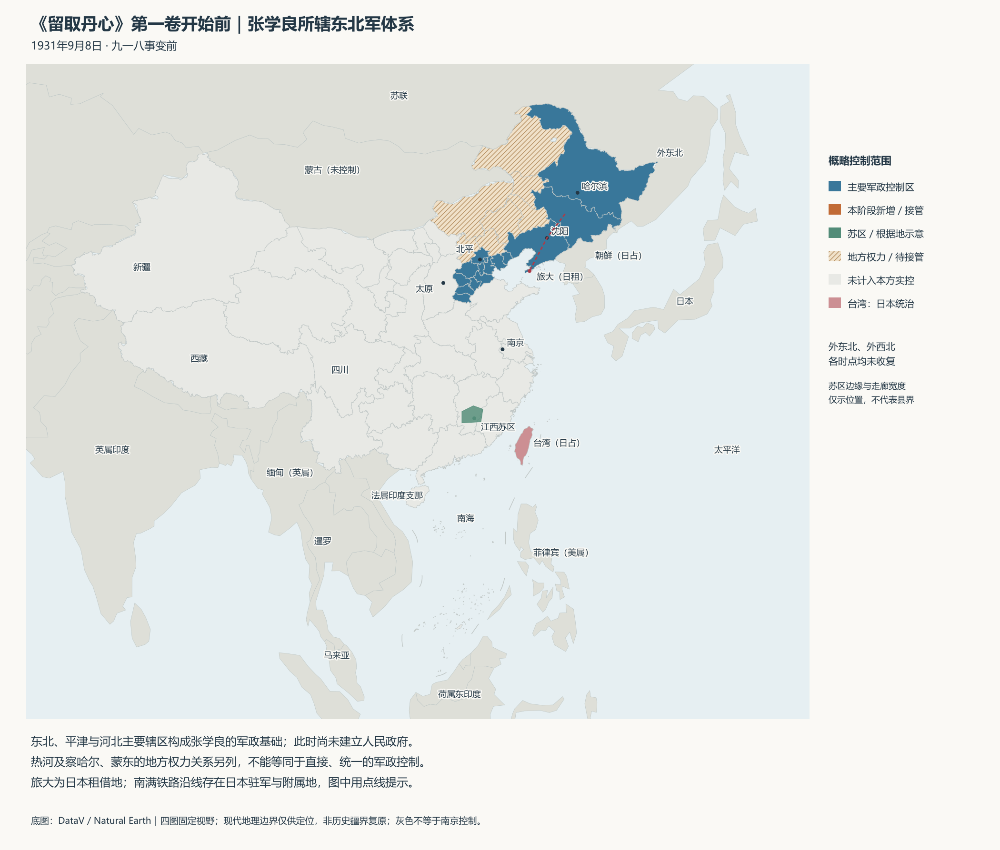
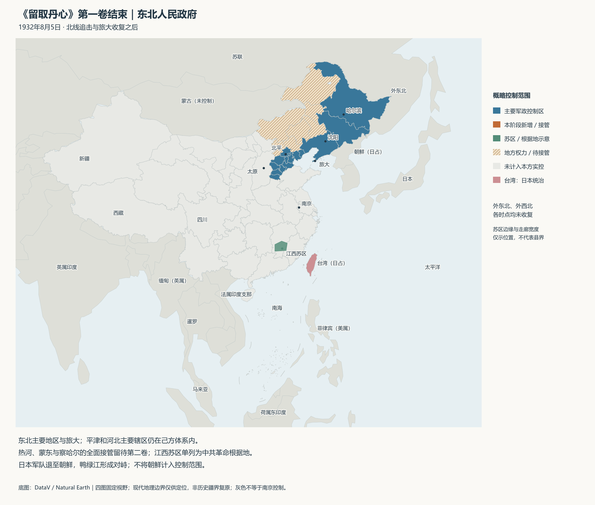
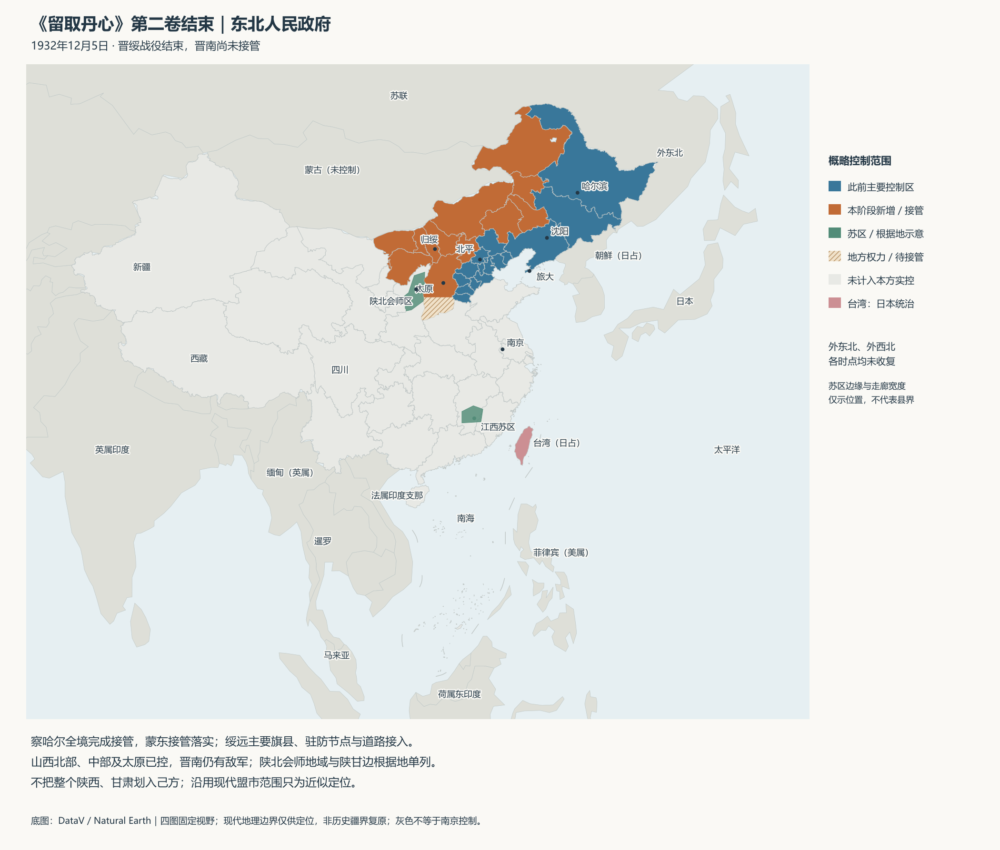
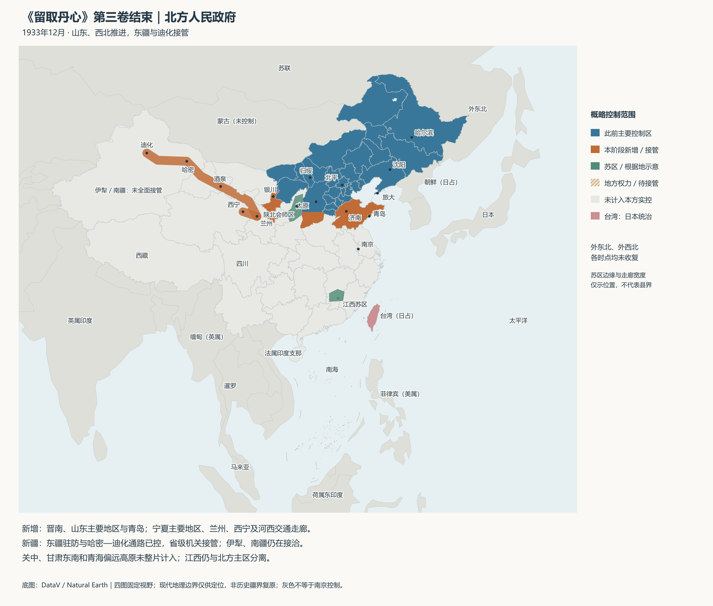
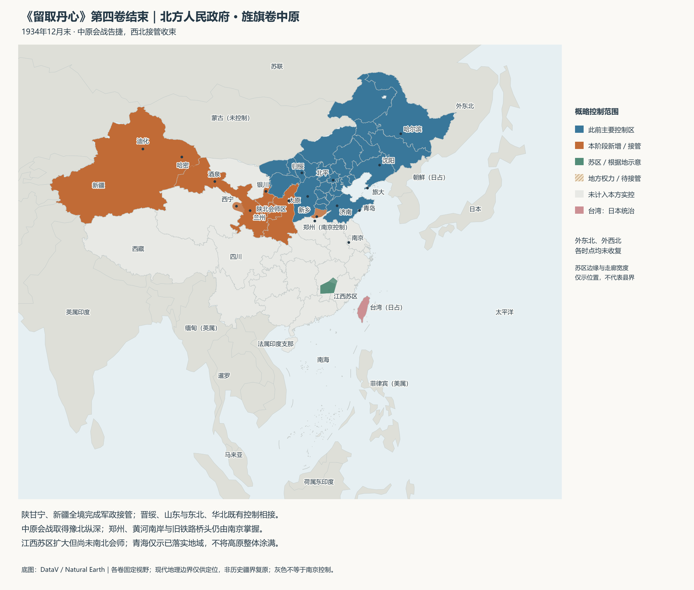
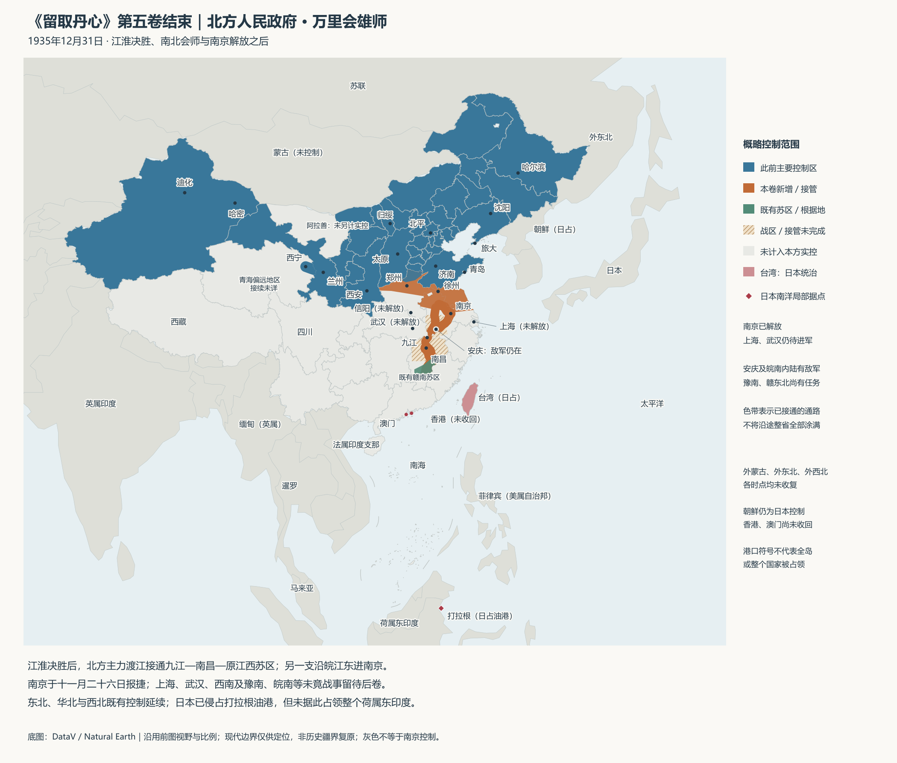
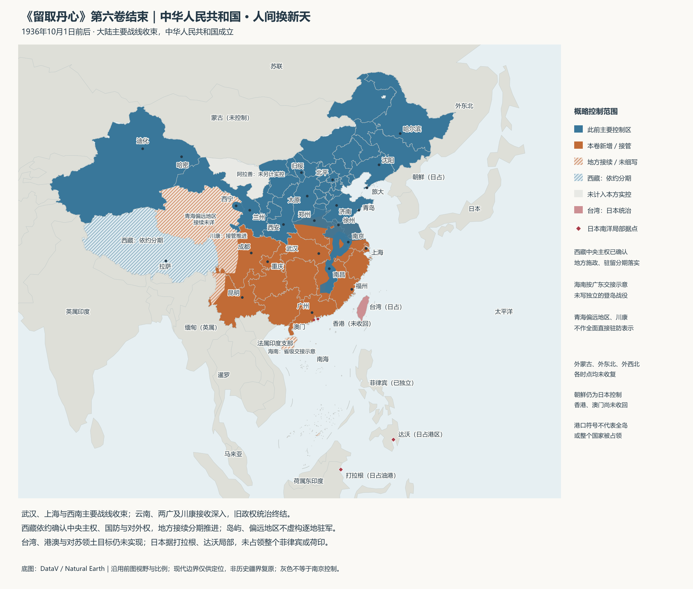

# 留取丹心

**架空历史 · 战争 · 革命 · 家国**

## 小说简介

魏文景，一名来自2023年新中国的医学博士，一觉醒来，成了1931年9月8日身在北平的张学良。

距离九一八事变，只剩十天。

他熟知那段山河破碎的历史，也记得无数未能活着迎来胜利的人。如今，枪声尚未响起，一切似乎还来得及。

可知道历史，究竟能改变多少？面对日寇的步步紧逼、旧部的暗中背叛和南京的重重掣肘，他将如何守住东北，与共产党携手，把抗日的烽火与革命的火种燃遍中国？

他从一个独立的新中国而来。他想让那些为她流尽鲜血的人，也能亲眼看见她站起来。

## 分卷与阅读

这里收录《留取丹心》**前六卷，共357章**。故事从九一八前夜展开，历经东北抗战、革命建设与全国解放，走向一个提前诞生的新中国。建议按卷次顺序阅读；在线章节、分卷下载与合集使用同一份大修版正文。

| 卷次 | 卷名 | 新章号 | 在线阅读 | TXT下载 |
| --- | --- | --- | --- | --- |
| 第一卷 | **山河未肯休** | 1—60 | [目录](CONTENTS.md) | [下载](https://github.com/PercyJacksonweiwenjing/liuqvdanxin/raw/refs/heads/main/留取丹心_第一卷.txt) |
| 第二卷 | **关山从头越** | 61—113 | [目录](CONTENTS-V2.md) | [下载](https://github.com/PercyJacksonweiwenjing/liuqvdanxin/raw/refs/heads/main/留取丹心_第二卷.txt) |
| 第三卷 | **长缨缚苍龙** | 114—173 | [目录](CONTENTS-V3.md) | [下载](https://github.com/PercyJacksonweiwenjing/liuqvdanxin/raw/refs/heads/main/留取丹心_第三卷.txt) |
| 第四卷 | **旌旗卷中原** | 174—233 | [目录](CONTENTS-V4.md) | [下载](https://github.com/PercyJacksonweiwenjing/liuqvdanxin/raw/refs/heads/main/留取丹心_第四卷.txt) |
| 第五卷 | **万里会雄师** | 234—294 | [目录](CONTENTS-V5.md) | [下载](https://github.com/PercyJacksonweiwenjing/liuqvdanxin/raw/refs/heads/main/留取丹心_第五卷.txt) |
| 第六卷 | **人间换新天** | 295—357 | [目录](CONTENTS-V6.md) | [下载](https://github.com/PercyJacksonweiwenjing/liuqvdanxin/raw/refs/heads/main/留取丹心_第六卷.txt) |

**第一卷《山河未肯休》**——距离九一八只剩十天。魏文景借张学良的身份调兵抵抗，在东北的血战中改变“不抵抗”的命运，也与共产党走到一起。守住山河之后，军队归谁、土地归谁，成为新的选择。

**第二卷《关山从头越》**——抗日的胜利挡不住旧势力的反扑。土改向乡村深入，蒙东与热河的积弊必须清算；人民军跨过长城、攻入晋绥，在关内的山路与城垣前，检验这支军队真正改变了多少。

**第三卷《长缨缚苍龙》**——山东的港口与西北的道路，逐渐接入北方政权。战线越拉越长，工厂、铁路和初生海军开始承担新的重担；进军西北，也让寻亲的线索与那些被历史埋没的命运重新浮现。

**第四卷《旌旗卷中原》**——南京倾力北上，中原大会战打响。彭德怀、张学良等人与国民党主力正面交锋，西北接管、列强干涉和鸭绿江边衅同时牵动全局。胜负不只取决于前线的枪炮，也取决于两种政权怎样组织和对待自己的人民。

**第五卷《万里会雄师》**——粟裕迎战杜聿明率领的精锐，毛泽东统筹跨战区的转进与决战。大军越过江淮、冲破封锁，终于与江西的同志们会师，继而迎来南京解放。魏文景逐步放下野战指挥，转入外交与城防，而海上的力量也在艰难成长。

**第六卷《人间换新天》**——战事从长江沿岸推向西南，旧政权走到最后的岔路口。海军合编、家人重逢与新收复地区的生活，同最后的决战一道展开。1936年10月1日，一个新的中国诞生；海峡对岸与南洋的战火，却提醒着所有人，和平还远未到来。

**[下载六卷合集 TXT](https://github.com/PercyJacksonweiwenjing/liuqvdanxin/raw/refs/heads/main/留取丹心_六卷合集.txt)** · [六卷合集 Markdown](留取丹心_六卷合集.md) · [全书目录](CONTENTS-ALL.md)

Markdown 分卷：[第一卷](留取丹心_第一卷.md) · [第二卷](留取丹心_第二卷.md) · [第三卷](留取丹心_第三卷.md) · [第四卷](留取丹心_第四卷.md) · [第五卷](留取丹心_第五卷.md) · [第六卷](留取丹心_第六卷.md)

六卷均免费阅读、免费下载。TXT链接若直接显示正文，可用浏览器“另存为”，或在文件页面点击 Download raw file。合集较大，建议下载后阅读。

旧版读者请查看[旧章号—新章号对照](CHAPTER-MAP.md)：旧书签中的章节数字可能已对应不同内容，按旧标题查找即可。原来的四卷合集下载地址继续保留，内容已同步为本版前四卷（第1—233章）。

本书为架空历史小说，请勿将小说情节当作史实引用。

## 故事疆域图

以下七张阶段示意图覆盖第一卷开始前及六卷各自结束时，沿用同一视野、同一比例，周边保留蒙古、朝鲜、日本和东南亚。**下文与[六卷地图说明](MAPS.md)含剧情信息。** 图色用于表示主要军政控制、接管或根据地，不能把整省着色、交通走廊宽度理解为精确县界或各地控制强度相同。

### 第一卷开始前 · 1931年9月8日

张学良所辖东北军体系。人民政府尚未建立；热河、察哈尔、蒙东地方势力关系与旅大日租地不能等同于直接控制。

### 第一卷《山河未肯休》结束 · 1932年8月5日

东北主战胜利，旅大收复，鸭绿江形成对峙。平津、河北主要辖区仍属己方体系；热河汤系、蒙东及察哈尔的全面接管留待第二卷。图中承德已按这一边界改为待接管，不再提前涂成实控。

### 第二卷《关山从头越》结束 · 1932年12月5日

蒙东、察哈尔接管落实，太原与晋中已控；归绥—包头主要驻防和交通接续，晋陕会师通路打开。晋南仍有敌军，陕北局部会师不等于全陕西已接管。

### 第三卷《长缨缚苍龙》结束 · 1933年12月

山东主要地区及青岛、宁夏主区、兰州、西宁、河西，以及哈密—迪化干线与关键驻军接续。**此时不是新疆全境已完成接管**：伊犁、南疆另有推进过程；关中、陕南、甘东南及青海偏远地区也不能一概涂成既得成果。

### 第四卷《旌旗卷中原》结束 · 1934年12月末

陕甘宁与新疆全境军政接管收束，中原大会战取得豫北纵深。郑州、黄河南岸与旧铁路桥头尚未收复；江西苏区仍未与北方主区相连。青海仅示已落实地域，不把高原整体计入直接控制。

### 第五卷《万里会雄师》结束 · 1935年12月31日

江淮决胜，郑州—开封—商丘交通与苏北、皖北战场取得进展。北方主力渡江接通九江—南昌—原江西苏区；另一支沿贵池、铜陵、芜湖向南京推进。南京已解放，上海、武汉仍待进军；信阳、安庆方向及皖南内陆、赣东北的未竟战事不提前涂成完成。

### 第六卷《人间换新天》结束 · 1936年10月1日前后

武汉、上海与西南主要战线收束，云南、两广及川康接收继续深入，中华人民共和国成立。西藏以蓝色斜纹表示中央主权获确认、地方施政与驻留依约分期落实；青海偏远地区等以斜纹区别于明确的直接控制。海南随广东军政交接作省级示意，不虚构正文未写的逐岛接管战役。

台湾、香港、澳门尚未收回，朝鲜仍由日本控制；外蒙古、外东北、外西北亦未收复。日本在打拉根油港、达沃港区的局部占领以点状符号标注，不代表整个荷印或菲律宾陷落。

底图采用 DataV 与 Natural Earth 地理数据，现代边界仅供定位；灰色不等于南京直接控制。地图属于小说设定，不是真实历史疆域图，也不等同于《留取丹心》游戏 MOD 的开局版图。

## 支持创作

如果这个故事曾让你热血、难过，或让你愿意陪这些人物再走一程，欢迎自愿赞助，支持《留取丹心》的后续创作。

**赞助完全自愿，不影响免费阅读与下载。量力而行，你愿意读下去，本身就是支持。**

| 支付宝 | 微信 |
| :---: | :---: |
|  |  |

点击图片可查看原图。支付前请在支付应用中核对收款人信息。

## 交流与勘误

欢迎通过本仓库的 [Issues](https://github.com/PercyJacksonweiwenjing/liuqvdanxin/issues) 留下阅读感想，或指出错字、时间线及情节问题。涉及后续情节时，请标明卷次和当前章号；如使用旧版，请同时提供标题。

## 版权说明

《留取丹心》版权由作者保留。本仓库公开提供阅读与个人下载，不代表作品采用开源软件许可证，也不授予未经许可的商业使用、出版或改编权。转载请先联系作者。
